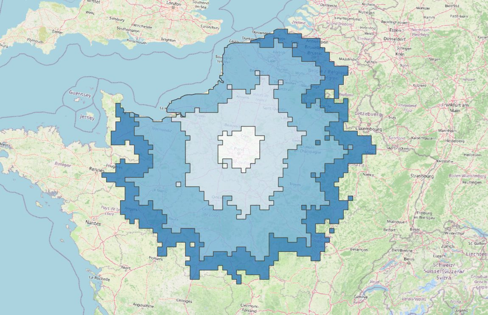
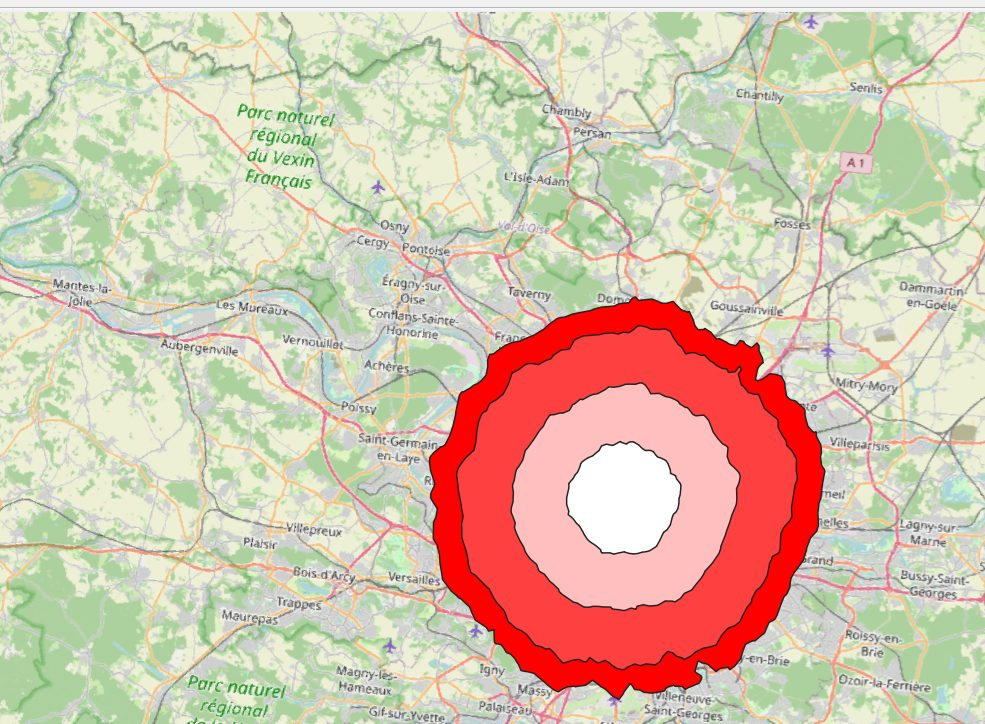
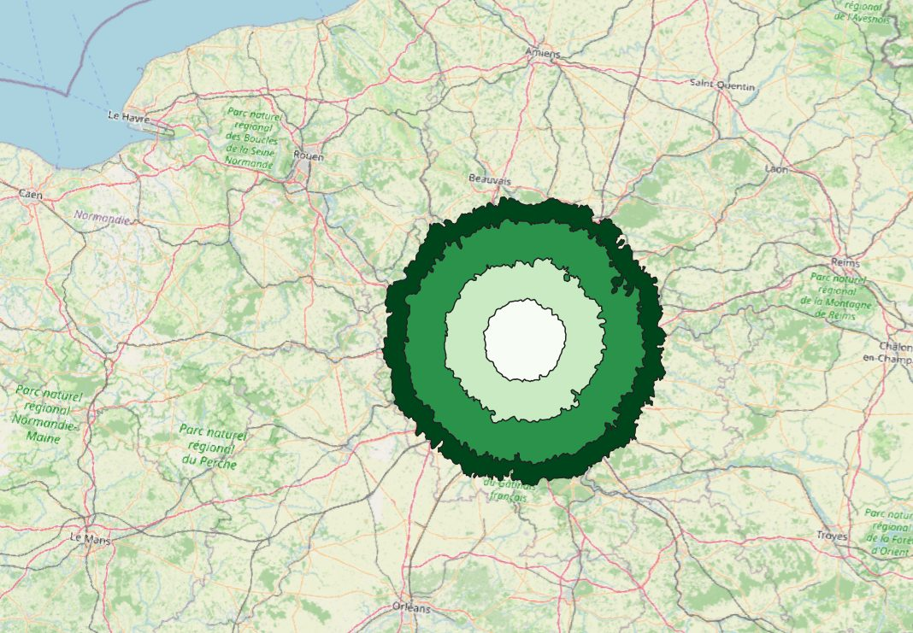
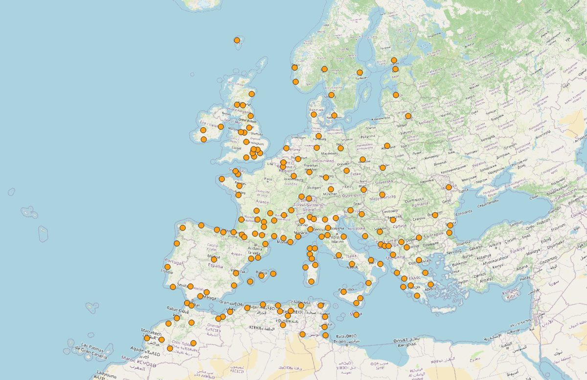

# 3h30 au départ de Paris : analyse comparée de cinq modes de transport

*Petite géographie d'une matinée passée à attendre mon tour.*

Un rendez-vous administratif à 9h, une attente de près de trois heures et demie, et une question : **si ce temps
avait été passé en route plutôt que sur une chaise, jusqu'où aurait-il mené ?**

Ce projet y répond à partir de données ouvertes, en comparant cinq modes de transport au départ de l'Île-de-France :
la marche, le vélo, la voiture, le train et l'avion.

**[Lire la storymap](https://arcg.is/i1bSG1)** · [Méthode détaillée](docs/methode.md) · [Notebook de traitement](notebooks/traitement.ipynb)



---

## Résultats

| Mode | Ce que permettent 3h30 à bord | Forme spatiale |
|---|---|---|
| Marche | 822 km², environ 16 km autour de la gare du Nord, sans quitter l'Île-de-France | une tache régulière |
| Vélo | 9 505 km² ; 3 départements hors Île-de-France (Oise, Eure, Eure-et-Loire) | une tache régulière |
| Voiture | 192 809 km² ; Lille en 2h16, Bruxelles en 3h14, Luxembourg | une tache étirée vers le nord-est |
| Train | 312 villes en trajet direct, dont 15 à l'étranger ; Marseille en 3h03, Brest en 3h26 | une étoile qui suit les lignes à grande vitesse |
| Avion | 165 destinations, des îles Britanniques à la mer Noire ; Athènes en 3h10 | un archipel dispersé |

Une observation se dégage de la comparaison des surfaces : à pied et à vélo, la zone atteinte est multipliée par
12 entre la première heure et la fin du trajet, ce qu'implique une vitesse constante (3,5² ≈ 12,25).
En voiture, elle est multipliée par 29 : la première heure est lente, puis le réseau autoroutier accélère la progression.

| Marche | Vélo | Avion |
|---|---|---|
|  |  |  |

## Règle du jeu

- **Budget-temps** : 210 minutes de **temps passé à bord**. L'accès aux gares et aux aéroports, l'attente et les contrôles ne sont pas comptés.
- **Départ** : la gare du Nord pour les modes routiers ; les sept terminus parisiens et les gares TGV de Roissy, Marne-la-Vallée et Massy pour le train ; Roissy-CDG et Orly pour l'avion.
- **Jour de référence** : mardi 6 octobre 2026, en retenant le trajet le plus rapide de la journée.
- **Destinations** : hors Île-de-France pour le train, la voiture et l'avion.

Ce cadrage a une conséquence assumée : il avantage l'avion, dont on ignore les temps d'accès et de formalités.
Il est discuté dans la [note méthodologique](docs/methode.md).

## Méthode en bref

| Mode | Données | Traitement |
|---|---|---|
| Train | GTFS « Horaires SNCF » | Circulations du jour de référence, exclusion des circulations en car, respect des montées et descentes autorisées, trajet direct le plus rapide par gare, rattachement aux communes |
| Voiture | openrouteservice (OSM) | La limite d'une heure des isochrones de l'API publique est contournée : grille de 4 746 points (pas de 10 km, ETRS89-LAEA), temps de trajet par l'endpoint *matrix*, reconstruction des isochrones par cellules |
| Avion | OurAirports, Wikipédia | Liaisons directes de Roissy et Orly, rapprochement des noms, modèle durée = f(distance) calibré sur six vols réels, signalement des destinations proches du seuil |
| Marche, vélo | openrouteservice (OSM) | Isochrones à 1h, 2h, 3h et 3h30 |

## Organisation du dépôt

```
zones-3h30-paris/
├── README.md
├── environment.yml          environnement conda
├── notebooks/
│   └── traitement.ipynb     chaîne de traitement complète, avec les sorties de l'exécution
├── data/
│   ├── README.md            sources à télécharger et emplacement attendu
│   ├── calibrage_avion.csv  durées de vol de référence
│   └── villes_etrangeres.csv
├── resultats/
│   ├── README.md            description des couches produites
│   └── geojson/             couches finales en WGS84
└── docs/
    ├── methode.md           méthode, contrôles et limites
    └── img/
```

## Reproduire l'analyse

1. **Créer l'environnement**

   ```powershell
   conda env create -f environment.yml
   conda activate zone_3h
   ```

   Sous Windows, si PostGIS ou QGIS ont défini une variable `PROJ_LIB` globale, GeoPandas peut lire la mauvaise base
   de projections. La surcharger pour cet environnement uniquement :

   ```powershell
   conda env config vars set PROJ_LIB="$env:CONDA_PREFIX\Library\share\proj" PROJ_DATA="$env:CONDA_PREFIX\Library\share\proj"
   conda deactivate; conda activate zone_3h
   ```

2. **Télécharger les données** décrites dans [`data/README.md`](data/README.md).

3. **Renseigner la clé openrouteservice** (gratuite sur [openrouteservice.org](https://openrouteservice.org)),
   sans jamais l'écrire dans le code :

   ```powershell
   conda env config vars set ORS_API_KEY="votre_cle"
   conda deactivate; conda activate zone_3h
   ```

4. **Exécuter le notebook** depuis la racine du dépôt :

   ```powershell
   jupyter lab
   ```

   puis ouvrir `notebooks/traitement.ipynb` et exécuter les cellules dans l'ordre. Les résultats sont écrits dans `resultats/`.

Le flux GTFS SNCF ne couvre que les mois à venir : pour reproduire exactement le jour de référence, il faut la
version archivée du jeu (voir `data/README.md`). Les résultats openrouteservice dépendent de l'état d'OpenStreetMap
et de la version du service au moment du calcul.

## Outils

Python (pandas, GeoPandas, Shapely, pyproj, requests), API REST openrouteservice, QGIS, ArcGIS Online / StoryMaps.

## Sources et licences

| Données | Producteur | Licence |
|---|---|---|
| Horaires des trains (GTFS) | SNCF Voyageurs, via transport.data.gouv.fr | ODbL |
| Itinéraires et isochrones | openrouteservice (HeiGIT), données © contributeurs OpenStreetMap | ODbL |
| Communes et populations légales 2023 | IGN, ADMIN EXPRESS COG ; INSEE | Licence Ouverte Etalab 2.0 |
| Contours des pays | Eurostat, GISCO | © EuroGeographics pour les limites administratives |
| Aéroports | OurAirports | Domaine public |
| Liaisons aériennes | Wikipédia, consultée le 8 octobre 2026 | CC BY-SA 4.0 |
| Durées de vol de référence | relevées sur Google Flights le 8 octobre 2026 | — |

Le code est publié sous licence MIT (voir [`LICENSE`](LICENSE)). Les couches de `resultats/`, dérivées de données
ODbL (SNCF, OpenStreetMap), sont publiées sous licence ODbL.

## Auteur

Lucas Ravelonjaka, géomaticien. Octobre 2026.
